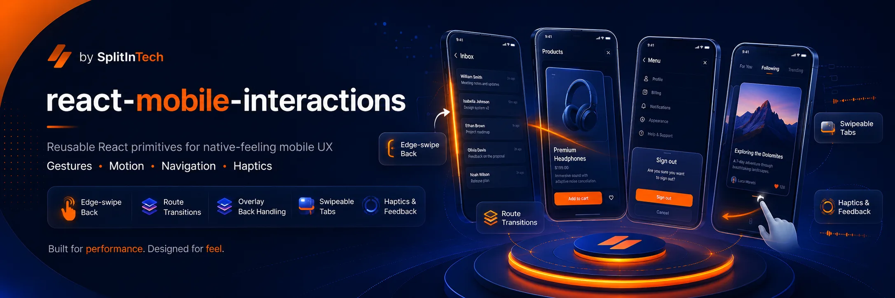

<p align="center">
  
</p>

<h1 align="center">Moggridge</h1>

<p align="center"><strong>Motion with a place to go—and a way back.</strong></p>
<p align="center">Shared interaction contracts for React, mobile web, PWAs, and React Native.</p>

<p align="center">
  <a href="https://github.com/splitintech/moggridge/actions/workflows/react-mobile-interactions.yml"></a>
  <a href="LICENSE"></a>
  <a href="https://www.npmjs.com/package/@splitin/react-mobile-interactions"></a>
</p>

Moggridge is the standalone home of **`@splitin/react-mobile-interactions`**, originally developed in SplitIn's `open-internal-tools` repository. The npm name and existing root imports stay the same. This repository brings the original swipe/back/navigation primitives, the expanded cross-platform catalog, and the original card-motion studies together in one library.

**Current status:** the source is a `1.0.0-beta.1` candidate. Moving it here does not publish that version to npm. Existing registry releases may expose only the earlier API. Use the packed-source installation below to try the new adapters. Browser and automated native checks are separate from physical-device, installed-PWA, and stable-release qualification; see [release status](docs/release.md).

[Try the lab](#run-the-motion-lab) · [Web quick start](#web-quick-start) · [React Native](#react-native) · [API entrypoints](#api-entrypoints) · [Compatibility](docs/compatibility.md) · [Migration](docs/migration.md)

## What it does

The library owns interaction state, interruption, cancellation, snapping policy, focus/back coordination, and semantic haptics. Framer Motion drives web animation; Reanimated and Gesture Handler drive native animation. React state does not carry animation frames.

| Interaction | Behavior |
| --- | --- |
| Press compression | Scale feedback with release/cancellation handling. |
| Mechanical press | An inner visual moves while the hit area stays in place. |
| Sliding selection | A measured indicator follows the selected item. |
| Elastic sheets | Snap points, resistance, scroll coordination, and dismissal. |
| Momentum and snapping | Bounded settling with platform-appropriate scrolling. |
| Interactive dismissal | Drag-linked progress, commitment, and reversal. |
| Lift, drag, and settle | Single-container lists/grids, stable IDs, autoscroll, and move alternatives. |
| Layout reflow | Position/layout transitions for changing content. |
| Anchored menus | Expansion with focus, dismissal, and positioning support. |
| Favorite reactions | Controlled selection with pending and rollback states. |
| Progress settling | Displayed progress stays within the confirmed value. |
| Anticipation | Finite squash/stretch sequences on an inner visual layer. |
| Coordinated rewards | Cancellable, seeded effects with event-ID deduplication. |

Beyond the catalog:

- **Reversible surfaces:** fullscreen, anchored, right-edge, and logical start/end expansion under a persistent `TransitionHost`.
- **Media continuity:** stable player ownership under `MediaHost`, with source/destination slots and router integration.
- **Original card studies:** listing, button, and pill expansion, the original image pullback, and spring-driven slides.
- **Reusable effects:** animated numbers/text, stagger, tilt, and the preserved Apple-style/generic preset collections.
- **Outside React:** disposable element bindings for map-marker visuals and other imperative elements.
- **Compatibility:** original root exports, overlay back layers, swipe tabs, edge-back, and route-transition primitives remain available.

The adapters share contracts, not identical browser/OS trajectories. Native scroll physics and optional integrations are reported as platform-specific. Cross-container/virtualized drag-and-drop and custom Swift/Kotlin effect implementations are outside the current scope.

## Run the motion lab

Use Node.js 22 or 24 and npm. From a fresh clone:

```bash
git clone https://github.com/splitintech/moggridge.git
cd moggridge
npm ci --legacy-peer-deps
npm run dev:lab
```

Open **http://127.0.0.1:4177**. The lab has four sections:

- **Catalog:** the 13 interaction patterns.
- **Card studies:** the original listing, button, and pill specimens.
- **Spatial & media:** reversible surfaces and persistent video.
- **Recipes:** combinations for product flows.

Controls include spring tuning, reduced motion, enabled/disabled and pending states, RTL, enlarged text, reset, and configuration export. Fixtures use local assets. Lab code and media assets are kept outside the published runtime bundle.

## Install the current source candidate

Until a qualified release is published, install an actual tarball rather than assuming the npm `beta` tag contains these APIs:

```bash
# In the moggridge checkout
npm run build
npm pack --ignore-scripts

# In your React application; replace the path with your checkout location
npm install /path/to/moggridge/splitin-react-mobile-interactions-1.0.0-beta.1.tgz \
  framer-motion@^12 @radix-ui/react-dialog @radix-ui/react-popover
```

The web adapter supports React 18/19 and Framer Motion 12. React and React DOM belong to the consuming app. Install `react-router-dom` only if you use the React Router integration. Adapter dependencies are optional peers so a web consumer does not need native engines.

The legacy root API remains available from the existing npm package, but that is not evidence that the new source candidate has been published.

## Web quick start

```tsx
import {
  MotionProvider,
  TransitionHost,
  MorphingSurface,
  PressableSurface,
} from '@splitin/react-mobile-interactions/web';

export function HomePreview() {
  return (
    <MotionProvider preset="soft" reducedMotion="system">
      <TransitionHost>
        <MorphingSurface
          id="home:123"
          label="Home details"
          description="Explore this home and return to the listing."
          presentation="right"
          trigger={<span>Explore this home</span>}
        >
          {close => (
            <div>
              <h2>A little room to breathe.</h2>
              <PressableSurface onClick={close}>Return to listing</PressableSurface>
            </div>
          )}
        </MorphingSurface>
      </TransitionHost>
    </MotionProvider>
  );
}
```

Keep `TransitionHost` mounted above the surfaces/routes it coordinates. Navigation and selection remain host-controlled. The router adapter owns its history transaction; avoid issuing a second push/pop from the close handler. See [adapter usage](docs/usage.md) for routing, media ownership, sheets, and imperative bindings.

### The original card motion

The original studies now consume the same public package APIs:

```tsx
import { cardMotionPresets } from '@splitin/react-mobile-interactions/presets';
import { SurfaceSlideTrack, useSurfaceImageScale } from '@splitin/react-mobile-interactions/web';
```

`useSurfaceImageScale(progress)` follows the host's reversible progress through the original `1.12 → 1.06 → 1` uniform pullback. `SurfaceSlideTrack` uses the original slide spring and a host-controlled index. `MorphingSurface` accepts `spring={cardMotionPresets.surface}` to preserve the original surface tuning.

Read the [card-motion integration guide](docs/card-motion-consolidation.md) for layout, reduced-motion, custom close controls, and the SplitIn lab synchronization contract.

## React Native

Use the New Architecture. The checked-in Expo and bare React Native fixtures pin their dependency sets and lockfiles; they are the reference integrations. The current fixture set includes Expo SDK 58, React Native 0.88, Reanimated 4.7.1, Worklets 0.13, and Gesture Handler 3.3. Check the fixture manifests before selecting versions for an existing app.

```tsx
import { Text } from 'react-native';
import { GestureHandlerRootView } from 'react-native-gesture-handler';
import { MotionProvider, PressableSurface } from '@splitin/react-mobile-interactions/native';

export function ContinueButton({ onContinue }: { onContinue: () => void }) {
  return (
    <GestureHandlerRootView style={{ flex: 1 }}>
      <MotionProvider preset="precise" reducedMotion="system">
        <PressableSurface accessibilityLabel="Continue" onPress={onContinue}>
          <Text>Continue</Text>
        </PressableSurface>
      </MotionProvider>
    </GestureHandlerRootView>
  );
}
```

To run the Expo lab:

```bash
npm ci --prefix examples/native
npm --prefix examples/native start
```

See [Expo setup](examples/native/README.md) and [bare React Native setup](examples/bare-native/README.md) for Metro resolution, Babel/worklets, safe areas, navigation, and native build prerequisites. `expo-haptics` and React Navigation integrations are optional. Native media uses one persistent player/surface in the example; physical-device video and clipping qualification remains a release gate.

## API entrypoints

| Import | Purpose |
| --- | --- |
| `@splitin/react-mobile-interactions` | Compatible original web swipe/back/navigation API. |
| `/core` | Portable contracts, lifecycle, snapping, gesture calculations, and card-motion tuning. |
| `/web` | DOM components, hooks, hosts, effects, and imperative bindings. |
| `/native` | React Native, Reanimated, and Gesture Handler adapters. |
| `/presets` | Portable spring families and original card-motion presets. |
| `/presets/apple` | Preserved Apple-style exports and reactive factory. |
| `/presets/generic`, `/presets/entrances`, `/presets/text` | Separate namespaces for existing visual effects. |
| `/integrations/react-router` | Persistent web navigation ownership. |
| `/integrations/react-navigation` | Native navigation integration. |
| `/integrations/expo-haptics` | Optional semantic haptic driver. |
| `/extensions` | Capability and lifecycle contract for future native effects. |
| `/web/compat`, `/web/css-motion`, `/web/swipe-intent`, `/core/legacy-swipe` | Migration and compatibility adapters. |

The root supports ESM/CommonJS. Web entrypoints must not import native engines; native entrypoints must not import React DOM or Framer Motion. Native source is included for consumer worklet transformation.

### Preset families

| Family | Stiffness | Damping | Mass |
| --- | ---: | ---: | ---: |
| `precise` | 500 | 30 | 0.5 |
| `soft` | 280 | 32 | 1 |
| `celebratory` | 300 | 18 | 0.8 |

These are configurable package defaults. Existing preset names and distinct tuning are preserved. The root's `shouldAnimate()` remains a function; the similarly named Apple compatibility export is a legacy static boolean. Use reactive policy hooks in new components.

## Accessibility and ownership

- Respect live system reduced-motion changes; disabled motion settles to the final state.
- Preserve focus restoration, keyboard activation, accessible names, and non-drag alternatives.
- Keep business state, pending/rejected actions, and navigation decisions in the host app.
- Assign one owner to each animated transform and gesture. Map SDKs retain geographic positioning; marker bindings animate an inner visual.
- Emit haptics at semantic events and avoid duplicating feedback already owned by the app.
- Treat OS fullscreen, picture-in-picture, and playback recovery separately from card expansion.

## Verify changes

```bash
npm run check:migration
npm run test:release-tools
npm run typecheck
npm test
npm run build
npm run check:package
npm run check:consumers
npm run build:lab
npx playwright install chromium firefox webkit
npm run test:browser
```

Packed-consumer checks cover React 18/19, ESM/CommonJS context sharing, SSR, TypeScript, Vite, and platform dependency isolation. Browser checks include the original card studies, reversal, focus, reduced motion, and media continuity. Native contracts and packed Metro checks run in the [native workflow](.github/workflows/react-mobile-interactions-native.yml); release compilation jobs are manually dispatched.

The Chromium visual-artifact test saves desktop and mobile screenshots inside its test directory under `test-results/`. CI uploads that directory as `motion-browser-22` or `motion-browser-24`, including failure traces when present. These screenshots are review artifacts; they are not a visual-regression baseline.

Historical validation is retained in [docs/evidence](docs/evidence). Evidence tied to an older source digest does not qualify this revision. A source build, simulator, or Metro bundle does not prove physical-device performance. Publishing is blocked unless the [release gates](docs/release.md) match the current source.

## Repository migration and SplitIn

This repository contains the reusable library and examples. SplitIn's application components, flags, business logic, and branded screens remain in the SplitIn repository. Its development gallery is synchronized from `examples/web`; its application consumes a packed or published dependency.

Relevant history from the former folder was preserved with rewritten paths. The original banner is reused unchanged. See [migration provenance](docs/migration.md) for the source-file manifest, commit mapping, and standalone-repository changes.

### Repository layout

| Path | Contents |
| --- | --- |
| `src/` | Original runtime, shared core, web/native adapters, presets, and optional integrations. |
| `examples/web/` | Browser motion lab, original card studies, and local media fixtures. |
| `examples/native/`, `examples/bare-native/` | Expo and bare React Native integration fixtures. |
| `tests/` | Unit, browser, native-contract, and release-tool checks. |
| `scripts/` | Build, packed-consumer, migration, and release validation tools. |
| `docs/` | Usage, compatibility, release gates, historical evidence, and migration provenance. |
| `.github/workflows/` | Standalone package checks, native qualification, and gated npm publishing. |

To verify the imported runtime, assets, and license against the recorded migration snapshot, run `npm run check:migration -- --snapshot`. This supplements the ordinary inventory/link check; it is expected to detect intentional runtime changes made after the migration.

## Contributing and releases

Read [CONTRIBUTING.md](CONTRIBUTING.md) for local checks and compatibility expectations. File bugs and proposals in [GitHub Issues](https://github.com/splitintech/moggridge/issues).

The npm package name stays `@splitin/react-mobile-interactions`. Source pushes do not publish packages. Release tags remain `react-mobile-interactions-v<version>`; the publishing workflow requires matching package versions, source-bound qualification, and npm trusted publishing configured for **`splitintech/moggridge`**. See [publishing](docs/publishing.md) before tagging a release.

## License

[MIT](LICENSE). Built by [SplitInTech](https://github.com/splitintech).
